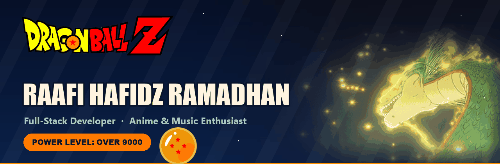
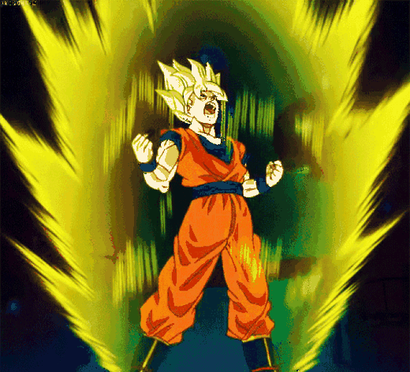

 

---

##  About me

<table>
<tr>
<td width="62%" valign="top">

I build practical tools that solve everyday problems — from an **Android TV launcher with a LAN remote** to a **Tidal + YouTube music downloader** with a built-in player. I like clean interfaces, automation, and turning small ideas into working products.

- 🛠️ Focused on **local-first tools** and **clean desktop/web experiences**
- 📺 Exploring **Android TV automation** and browser-based remotes
- 🎧 Making **music workflows** simpler, one utility at a time
- 💬 Happy to talk about **Python, Java, TypeScript, or Android TV**

</td>
<td width="38%" align="center" valign="middle">

<b>⚡ Power level: OVER 9000</b>

</td>
</tr>
</table>

---

##  Dragon Radar · Toolbox

  
  
  
  
  
  
  
  
  

---

##  Featured projects

|  Project | What it does | Stack |
| :--- | :--- | :--- |
| [**CleanYourTV Extended**](https://github.com/RaafiHafidzRamadhan/cleanyourtvextended) | Android TV launcher with a LAN-only web remote, local ADB control, and a prayer/notes/todos screensaver. Extended from Gathin23's CleanYourTV. | `Java` · `ADB` · `Web` |
| [**TDL Music**](https://github.com/RaafiHafidzRamadhan/tdl-music-downloader-extended) | Tidal + YouTube music downloader with a modern white/blue UI, circular progress, and a player that shows real audio formats like FLAC and MP3. Extended from Fthzx20's original project. | `Python` · `CustomTkinter` · `yt-dlp` |
| [**Netflix Clone**](https://github.com/RaafiHafidzRamadhan/netflix-clone) | Full-stack movie streaming app with authentication, video uploads, playback, and an admin dashboard. | `Next.js` · `Prisma` · `NextAuth` |
| [**WinUpdate Disabler**](https://github.com/RaafiHafidzRamadhan/winupdate-disabler) | Batch utility to pause Windows Update (until 2077) or re-enable it on Windows 10 Home. | `Batch` · `Windows` |

---

##  Power level · GitHub stats

 

---

> *"Power comes in response to a need, not a desire."* — **Goku**

---

### Thanks for stopping by 🐉

*Good tools should feel simple — and every great build starts with a power-up.*

Dragon Ball and all related characters © Bird Studio, Shueisha, and Toei Animation. This is a fan-made profile for non-commercial use. 
Art sourced from the web: <a href="https://dragonball.fandom.com/">Dragon Ball Wiki</a> (logo &amp; dragon ball), <a href="https://tenor.com/view/shenlong-shenron-dragon-ball-summon-dragonball-gif-8946646512229073363">Tenor</a> (Shenron), and Sohu CDN (Goku power-up).

